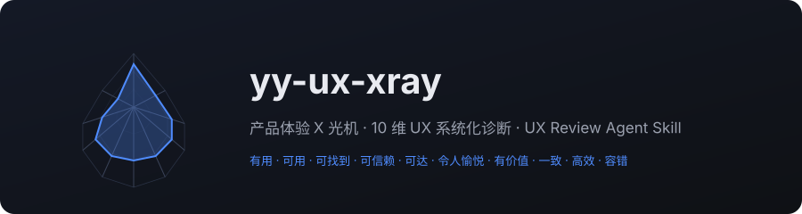

# yy-ux-review · 产品体验系统化审查




> 一个给 AI 编程助手用的 UX 审查技能：沿真实用户任务流，用 10 个维度系统化诊断产品体验问题，输出带评级的 HTML 审查报告。决策不靠「我觉得」。

## 核心特性

- **10 维诊断框架**：有用、可用、可找到、可信赖、可达、令人愉悦、有价值、一致、高效、容错——覆盖从新用户首用到老用户高频操作的全生命周期
- **任务流驱动**：先锁定「谁在什么场景下完成什么任务」，沿步骤链逐环节打点，不孤立评价页面好不好看
- **可验证闭环**：每条修复建议绑定验证指标（任务完成率、平均耗时、错误率、用户反馈），优化前后有数据可比
- **零依赖纯文档**：SKILL.md + 检查清单 + HTML 报告模板，任何支持 Skill 的 Agent 装上即用

## 效果示例

<!-- 待插入：HTML 审查报告实拍截图——维度雷达 + 问题清单（建议 1600x900 png） -->

报告包含：中心论断 → 10 维雷达得分 → 任务流问题打点图 → 按严重度排序的问题清单（每条含位置、证据、影响、修复建议）→ 优先级矩阵 → 验证指标表。

## 安装

方式一：把仓库地址发给你的 AI 助手，让它安装这个 Skill。

方式二：命令行安装：

```bash
npx skills add ivercurry99/yy-ux-review
```

方式三：手动安装——把本仓库的 `SKILL.md`、`references/`、`assets/` 复制到项目的 `.trae/skills/yy-ux-review/` 目录下。

## 使用

安装后直接对 Agent 说：

```text
帮我审查一下这个产品的 UX：https://example.com
# 或：这是我 App 的注册流程截图，做个 UX 体检
```

Agent 会先确认目标用户与核心任务流，然后逐环节过 10 个维度，最后生成一份自包含的 HTML 审查报告。

## 兼容范围与边界

- 适用于网站、App、小程序等数字产品的体验诊断；输入可以是 URL、截图、录屏、设计稿或 PRD
- 不做视觉美化、不写实现代码、不代替真实用户测试——它产出的是「有据可依的问题清单」，真实数据仍需上线后采集

## License

[MIT](./LICENSE)
